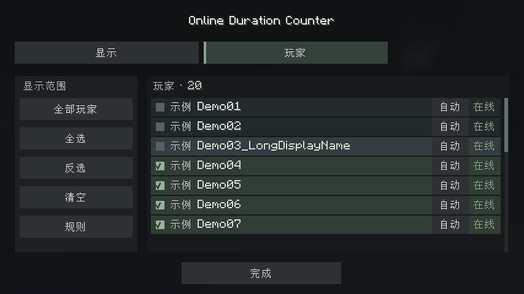

# Online Duration Counter (ODC)

适用于 **Minecraft 1.21.11 / Fabric** 的在线时长统计模组，无需开启作弊。

**[下载最新版](https://github.com/wiknzylix/Online-Duration-Counter/releases/latest)** · [详细说明](README.zh-CN.md) · [更新记录](CHANGELOG.zh-CN.md)

## 安装

需要 Java 21、Fabric Loader 0.18.4 或更新版本，以及 Fabric API。已验证 Fabric API 0.141.4+1.21.11；Mod Menu 17.0.0 可选。

房主或服务器将发布页的模组 JAR 放入 `mods` 文件夹；需要显示侧栏的客户端也安装同版 ODC 与 Fabric API。升级时替换旧 JAR。默认按 **Y** 打开配置。

## 功能

- 服务器统一记录累计在线时长，支持在线/离线排名和原版历史统计导入。
- 侧栏可调整位置、宽高、字号、颜色、透明度和玩家显示范围。
- 支持关键词、正则、数字 ID、Carpet 假人筛选，以及手动身份校正；隐藏不删除记录。
- 支持 QB 备份流程，时长和服务端身份历史随存档回退。

## 构建

使用 JDK 21，Windows 执行 `gradlew.bat build`；Linux/macOS 执行 `sh gradlew build`。产物位于 `build/libs`。测试范围见 [测试说明](TESTING.zh-CN.md)。

MIT License · 作者：**GPT-6.1 Sol、wiknzylix**。
